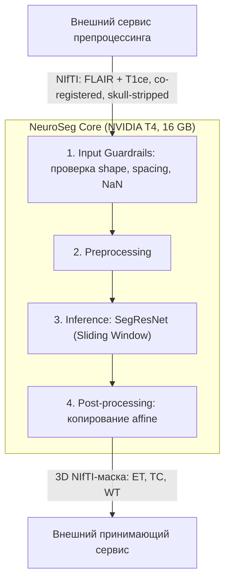
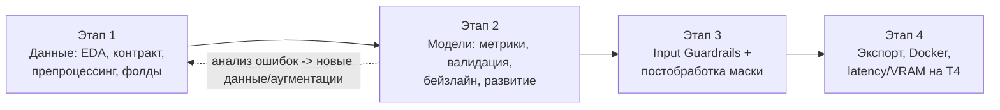

# ML System Design Doc - [RU]

## Дизайн ML системы - NeuroSeg Core MVP 1.1

> **Changelog (пересмотр границ MVP 1.0):** по итогам созвонов с заказчиком и архитектурной декомпозиции границы системы сужены до изолированного ML-ядра сегментации. Задачи препроцессинга (корегистрация, удаление костей), упаковки в DICOM, рендеринга заключений и оркестрации инференса (Triton/Kafka) вынесены в зону ответственности смежных платформенных сервисов.

## Содержание

- [0. Глоссарий](#0-глоссарий)
- [1. Цели и предпосылки](#1-цели-и-предпосылки)
  - [1.1. Зачем идём в разработку продукта?](#11-зачем-идём-в-разработку-продукта)
  - [1.2. Бизнес-требования и ограничения](#12-бизнес-требования-и-ограничения)
  - [1.3. Что входит в скоуп проекта/итерации, что не входит](#13-что-входит-в-скоуп-проектаитерации-что-не-входит)
  - [1.4. Предпосылки решения](#14-предпосылки-решения)
- [2. Методология](#2-методология)
  - [2.1. Постановка задачи](#21-постановка-задачи)
  - [2.2. Блок-схема решения](#22-блок-схема-решения)
- [3. Этапы решения задачи](#3-этапы-решения-задачи)
  - [3.1. Этап 1. Подготовка данных](#31-этап-1-подготовка-данных)
  - [3.2. Этап 2. Подготовка прогнозных моделей](#32-этап-2-подготовка-прогнозных-моделей)
  - [3.3. Этап 3. Входной контроль (Input Guardrails) и морфологическая постобработка](#33-этап-3-входной-контроль-input-guardrails-и-морфологическая-постобработка)
  - [3.4. Этап 4. Экспорт модели, упаковка и замеры производительности на T4](#34-этап-4-экспорт-модели-упаковка-и-замеры-производительности-на-t4)

### 0. Глоссарий

- **NIfTI (`.nii` / `.nii.gz`)** — стандартный для ML в нейровизуализации формат хранения 3D/4D медицинских объемов. В отличие от сырого клинического DICOM (где каждый 2D-срез лежит в отдельном файле с кучей метаданных пациента), NIfTI хранит весь 3D-тензор единым массивом вместе с пространственной матрицей (`affine`).
- **DICOM (`.dcm`)** — индустриальный стандарт передачи и хранения данных в больницах (напрямую с томографа). Не подается на вход нашей модели; конвертацией в NIfTI и обратно занимаются внешние сервисы.
- **Модальности МРТ (`FLAIR`, `T1ce`, `T1`, `T2`)** — разные режимы сканирования, работающие как цветовые каналы в RGB-картинке. В нашем проекте используются только две.
- **Co-registration (корегистрация)** — пространственное выравнивание (совмещение) разных модальностей МРТ одного пациента в единую систему координат, чтобы конкретный воксель $(x, y, z)$ (аля "пространственный пиксель") на `FLAIR` соответствовал ровно той же анатомической точке на `T1ce`.
- **Воксель (Voxel)** — 3D-аналог пикселя (элемент трехмерной сетки).
- **Skull-stripping (brain extraction)** — этап предобработки, на котором с 3D-снимка алгоритмически удаляются кости черепа, кожа и глаза, оставляя только ткани головного мозга.
- **Spacing (разрешение вокселя)** — физический размер одного вокселя в миллиметрах по осям $(dx, dy, dz)$ (например, $[1.0, 1.0, 1.0]$ мм). Критически важен для 3D-сверток: если `spacing` плавает от снимка к снимку, масштабы объектов в рецептивном поле сети искажаются.
- **Изотропный воксель** — воксель в форме идеального куба ($dx = dy = dz$, в стандарте BraTS — $1 \times 1 \times 1$ мм).
- **Affine (аффинная матрица, $4 \times 4$)** — матрица преобразования координат из заголовка NIfTI. Она связывает индексы вокселей в массиве $(i, j, k)$ с реальными физическими координатами пациента в пространстве томографа $(x, y, z)$. Потеря или искажение `affine` приведет к тому, что предсказанная маска «съедет» относительно мозга при наложении в программу для просмотра.
- **Глиома** — первичная опухоль головного мозга, для которой характерна сложная вложенная структура (матрёшка).
- **ET (Enhancing Tumor)** — активно растущая, накапливающая контраст часть опухоли (хорошо видна на `T1ce`).
- **TC (Tumor Core)** — ядро опухоли, объединяющее `ET` и некротическое (отмершее) ядро внутри него.
- **WT (Whole Tumor)** — весь видимый объем поражения, объединяющий `TC` и окружающий его перитуморальный отек (хорошо виден на `FLAIR`).
- **BraTS (Brain Tumor Segmentation)** — главный международный бенчмарк и открытый датасет по сегментации глиом на МРТ.
- **SegResNet** — 3D-энкодер-декодер архитектура на базе ResNet-блоков с skip-connections (из фреймворка **MONAI**), де-факто индустриальный стандарт для задач 3D-сегментации в медицине.
- **HD95 (95th percentile Hausdorff Distance)** — метрика точности границ в миллиметрах (95-й перцентиль расстояния Хаусдорфа). Показывает, насколько сильно контур предсказанной маски отклоняется от разметки врача, игнорируя единичные выбросы (верхние 5%).

### 1. Цели и предпосылки

#### 1.1. Зачем идем в разработку продукта?

- **Бизнес-цель:** разработать кастомное ML-ядро для автоматической 3D-сегментации глиом по заказу медицинской сети клиник, которая в данный момент не использует средства автоматизации разметки. Цель внедрения на стороне заказчика — ускорить рутинную оценку очагов поражения врачами-радиологами.
- **Почему станет лучше:** для увеличения пропускной способности аппаратов МРТ клиника-заказчик часто использует сокращенный протокол исследования (только 2 модальности: `FLAIR` и постконтрастный `T1ce`). Существующие на рынке готовые решения требуют на вход полного набора из 4 последовательностей (`T1`, `T1ce`, `T2`, `FLAIR`) и критически деградируют в качестве при отсутствии двух из них. Это формирует потребность в разработке кастомной модели, устойчиво работающей в условиях ограниченного протокола заказчика.
- **Что будем считать успехом итерации:**
  1. Качество сегментации (`Dice` и `HD95` по регионам `WT`, `TC`, `ET`) сопоставимо с сильным открытым baseline (SegResNet).
  2. Соблюдение SLA: инференс 3D-объема укладывается в целевой порог `T_max` секунд на целевом железе (NVIDIA T4 16 ГБ VRAM) _(точное значение SLA согласуется с заказчиком по итогам замеров на бейзлайне)_.
  3. На закрытой выборке заказчика врач-эксперт подтверждает пригодность масок (бизнес-валидация).

#### 1.2. Бизнес-требования и ограничения

- **Бизнес-требования:**
  - На входе: два корегистрированных 3D `nifti`-файла (`FLAIR` и постконтрастный `T1ce`) с выполненным удалением черепа (поступают от внешнего сервиса препроцессинга).
  - На выходе: 3D NIfTI-маска с метками субрегионов опухоли (`ET`, `TC`, `WT`), сохраняющая исходную аффинную матрицу входного исследования для точной пространственной привязки в принимающем сервисе.
- **Бизнес-ограничения:**
  - _Юридические (152-ФЗ):_ медицинские данные нельзя отправлять во внешние API.
  - _Инфраструктурные:_ выделяется сервер с 16 ГБ VRAM для обучения и инференса.
  - _Производительность (SLA):_ целевое время обработки одного исследования (`latency`) находится в статусе `TBD` и будет зафиксировано после согласования требований к пропускной способности с заказчиком и проведения бенчмаркинга бейзлайна.
  - _Архитектурные:_ обязательная валидация входных тензоров (совпадение `shape`, `spacing`) перед подачей в модель.
- **Описание бизнес-процесса пилота:** внешний сервис препроцессинга готовит NIfTI -> передает пути/файлы в ML-сервис (`NeuroSeg Core`) -> ML-сервис валидирует входы, выполняет 3D-инференс и постобработку -> возвращает NIfTI-маску принимающему сервису клиники (который отвечает за конвертацию в DICOM и отображение врачу).

#### 1.3. Что входит в скоуп проекта/итерации, что не входит

- **Входит в скоуп MVP:**
  - Работа с зафиксированным датасетом (BraTS) в формате NIfTI (с фильтрацией под 2 целевые модальности (`FLAIR`, `T1ce`) и уже прошедшим удалением костей).
  - Обучение и валидация 3D-модели сегментации (SegResNet) на 2-канальном входе (FLAIR, T1ce).
  - Модуль входного контроля качества данных и алгоритмическая постобработка масок (наследование `affine`).
  - Упаковка ML-ядра в воспроизводимый Python-модуль / Docker-образ с REST/CLI-интерфейсом и экспортом весов в `ONNX` / `TorchScript`.
- **Не входит в скоуп MVP:**
  - Обработка сырых клинических DICOM-файлов (регистрация, удаление черепа).
  - Развертывание оркестраторов уровня Triton Inference Server и брокеров сообщений.
  - Конвертация масок в DICOM.

#### 1.4. Предпосылки решения

- **Данные:** Открытые размеченные датасеты (BraTS). Данные уже предобработаны (изотропный воксель, совмещенные модальности, кости удалены), что полностью соответствует формату данных, который наш модуль будет получать от внешнего сервиса препроцессинга.
- **Бейзлайн:** Архитектура `SegResNet` (MONAI), адаптированная под 2 входных канала (`FLAIR`, `T1ce`).

### 2. Методология

#### 2.1. Постановка задачи

Задача формулируется как **3D Semantic Segmentation** (повоксельная многоклассовая классификация 3D-тензора МРТ):

- `ET` (Enhancing Tumor) — контрастируемая часть опухоли;
- `TC` (Tumor Core) — ядро опухоли (`ET` + некротическое ядро);
- `WT` (Whole Tumor) — весь объем поражения (`TC` + перитуморальный отек).

#### 2.2. Блок-схема решения

Ниже представлена схема работы изолированного ML-ядра (`NeuroSeg Core`) и его взаимодействия со смежными сервисами:

### 3. Этапы решения задачи

> **Примечание по статусу расчётов:** из-за некоторых обстоятельств с датацентрами одной красной компании сейчас идет обсуждение с другими провайдерами по аренде видеокарт, команда обещала к `16.11` предоставить доступы (свои личные лимиты в колабе, увы, исчерпаны с нескольких аккаунтов) и ограничений бесплатного Google Colab по объёму диска и RAM для распаковки полного датасета BraTS, прогон полного цикла вычислений временно отложен. Архитектура этапов, конфиги и воспроизводимый код разведочного анализа (`notebooks/01_eda_brats.ipynb`) подготовлены и зафиксированы в репозитории. Эмпирические статистики и визуализации будут добавлены в документ после выделения ресурсов на GPU (NVIDIA T4).

Решение разбито на 4 этапа. Этапы 1–2 — стандартные для ML-проекта; этапы 3–4 специфичны для 3D-сегментации в медицинском контуре (контракт на входные тензоры, сохранение координатной привязки и инференс в жёстком бюджете 16 ГБ VRAM).

#### 3.1. Этап 1. Подготовка данных

##### 3.1.1. Описание данных и сущностей

В MVP используется открытый датасет **BraTS 2021 (Task 1)**, доступный через Kaggle (`dschettler8845/brats-2021-task1`). Из него для каждого пациента берутся только нужные нам файлы; `T1` и `T2` при загрузке отбрасываются.

| Сущность | Описание | Формат / параметры |
|---|---|---|
| Пациент (кейс) | Одно исследование = один пациент, ID вида `BraTS2021_xxxxx`. Единица группировки при валидации | — |
| Канал `0` — `FLAIR` | 3D МРТ, отёк хорошо виден как гиперинтенсивная область | NIfTI, `240×240×155`, воксель `1×1×1` мм |
| Канал `2` — `T1ce` | 3D постконтрастная T1, накапливающая контраст часть опухоли (`ET`) | NIfTI, тот же `shape` / `affine` |
| Разметка `seg` | Метки `0` (фон), `1` (NCR — некротическое ядро), `2` (ED — отёк), `4` (ET) | NIfTI, целочисленные метки |
| Целевые субрегионы | `WT = {1,2,4}`, `TC = {1,4}`, `ET = {4}` — вложенные бинарные маски `WT ⊃ TC ⊃ ET` | 3 канала, перекрывающиеся (multi-label) |

Каналы `1` (`T1`) и `3` (`T2`) исключены сознательно: они имитируют сокращённый протокол сканирования (только `FLAIR` + `T1ce`), на который ориентирован проект.

Сводные статистики данных (результаты ноутбука `notebooks/01_eda_brats.ipynb`, ячейки §3 и §8):

| Показатель | Значение |
|---|---|
| Число кейсов с полным набором (`FLAIR` + `T1ce` + `seg`) | [*ожидает прогона*] |
| Кейсов, не прошедших чтение / с несовпадением `shape` | [*ожидает прогона*] |
| Объём `FLAIR` + `T1ce` + `seg` на диске, ГБ | [*ожидает прогона*] |
| Уникальные `shape` / `spacing` / ориентации осей | [*ожидает прогона*] |
| Кейсов с `NaN` / `Inf` / отрицательными интенсивностями | [*ожидает прогона*] |
| Кейсов с несовпадением `affine` между `FLAIR`, `T1ce` и `seg` | [*ожидает прогона*] |
| Кейсов с метками вне `{0,1,2,4}` / с пустой разметкой | [*ожидает прогона*] |
| Доля вокселей мозга в объёме тома (среднее, min–max), % | [*ожидает прогона*] |

##### 3.1.2. Результаты EDA: объём, качество, разметка

EDA выполнен в `notebooks/01_eda_brats.ipynb` (графики: `docs/images/`, таблицы: `docs/eda_tables/`). Ниже — графики с интерпретацией. Конкретные числа подставляются из `docs/eda_tables/eda_summary.json` после запуска в Colab.

**Состав и качество данных.**

- Все кейсы проверяются по контракту, который в продакшне обеспечивает Input Guardrails (этап 3): совпадение `shape` / `spacing` / `affine` между каналами, отсутствие `NaN`/`Inf`, читаемость файлов, допустимый набор меток. Нарушений контракта на BraTS: [*ожидает прогона*].
- Мозг занимает [*ожидает прогона*] % вокселей тома, а его bbox — [*ожидает прогона*] %. Значит, значительная часть тома — нули после skull-stripping, поэтому кроп по ненулевой области (`CropForegroundd`) сокращает объём вычислений и вклад фона в лосс.

**Дисбаланс классов и объёмы субрегионов.**

- Опухоль (`WT`) в среднем занимает [*ожидает прогона*] % вокселей мозга, `TC` — [*ожидает прогона*] %, `ET` — [*ожидает прогона*] %. Дисбаланс «фон / опухоль» и «`WT` / `ET`» выражен: взвешенная по вокселям кросс-энтропия будет смещать предсказания в сторону фона.
- Медианные объёмы `WT` / `TC` / `ET`, мл: [*ожидает прогона*]; 5–95 перцентили `WT`: [*ожидает прогона*]. Разброс размеров опухоли большой, поэтому метрики нужно анализировать по бинам объёма, а не только в среднем.
- Пациентов без `ET`: [*ожидает прогона*] (доля [*ожидает прогона*] %); с «крошечной» `ET` (< 100 вокселей): [*ожидает прогона*]. Для них Dice по `ET` не определён, поэтому нужен явный протокол оценки (см. этап 2).

**Геометрия и локализация опухоли.**

- `WT` состоит из нескольких связных компонент у [*ожидает прогона*] % кейсов. Если доля существенна, постобработка «оставить только наибольшую компоненту» может удалить настоящие очаги → вместо неё используется фильтрация по порогу объёма (этап 3).
- Размер bbox опухоли (медиана / 95-й перцентиль / максимум), мм: [*ожидает прогона*]. Это ориентир для `roi_size` патча (128³) и для оценки, помещаются ли крупные опухоли в один патч.
- По тепловой карте: [*ожидает прогона* — описать, где концентрируются опухоли]. Если локализация неравномерна, случайные патчи надо брать со смещением в сторону опухоли (`RandCropByPosNegLabeld`, `pos > neg`).

**Интенсивности и доменный сдвиг.**

- Размер эффекта (Cohen d) подобласти опухоли относительно здоровой ткани: `FLAIR` — [*ожидает прогона*], `T1ce` — [*ожидает прогона*]. Ожидаемо, `FLAIR` информативнее для `ED`/`WT`, а `T1ce` — для `ET`/`TC`; обе модальности нужны (гипотеза, подтверждается или опровергается числами из ноутбука).
- Распределения субрегионов перекрываются между собой и со здоровой тканью (см. гистограммы), поэтому пороговая сегментация неприменима, нужна контекстная 3D-модель.
- Коэффициент вариации p99-интенсивности мозга между кейсами: `FLAIR` [*ожидает прогона*] %, `T1ce` [*ожидает прогона*] %. У МРТ нет физической шкалы интенсивности (в отличие от КТ), поэтому без нормализации каждого кейса модель выучит масштаб конкретного сканера.

**Визуальный контроль разметки.**

- Контуры `WT` должны совпадать с зоной гиперинтенсивности на `FLAIR`, `ET` — с контрастируемыми структурами на `T1ce`, вложенность `WT ⊃ TC ⊃ ET` соблюдается по построению. Границы разметки субъективны → для оценки границ надёжнее `HD95`, а не `HD`. [*ожидает прогона* — подтвердить или скорректировать по просмотру срезов]

##### 3.1.3. Выявленные проблемы и риски

| № | Проблема / риск | Источник (EDA) | Влияние | Митигация |
|---|---|---|---|---|
| 1 | Сильный дисбаланс классов: опухоль — малая доля вокселей мозга, `ET` — самая малая | `eda_02` | Модель «схлопывается» в предсказание фона, низкий Dice по `ET` | Составной лосс `DiceLoss + CrossEntropyLoss`; патчи с `pos > neg`; метрики отдельно по `WT`/`TC`/`ET` |
| 2 | Пациенты без `ET` и с крошечной `ET` | `eda_02` | Dice не определён / нулевой, нестабильные метрики по фолдам | Стратификация фолдов по наличию `ET`; протокол «пусто = пусто → Dice 1»; отдельный отчёт по этой группе |
| 3 | Нестандартизированная шкала интенсивностей между сканерами | `eda_05`, `eda_06` | Доменный сдвиг, особенно на данных другой клиники | Поканальная нормализация (`NormalizeIntensityd`), интенсивностные аугментации; проверка на отложенной выборке |
| 4 | Многокомпонентная опухоль | `eda_03` | Агрессивная постобработка удалит реальные очаги | Фильтрация по порогу объёма вместо `KeepLargest` |
| 5 | Мелкие опухоли и большой разброс размеров | `eda_02`, `eda_03` | Мелкие очаги теряются при кропе и сэмплинге патчей | Смещённый сэмплинг патчей; анализ метрик по бинам объёма |
| 6 | Субъективность границ разметки | `eda_08`, `eda_09` | Потолок достижимого Dice/HD95, шум в метках на границе | `HD95` вместо `HD`; не переобучаться на границы; ансамблирование |
| 7 | Разметка BraTS получена полуавтоматически с ручной коррекцией (характеристика датасета) | описание датасета | Возможный систематический сдвиг относительно «чистой» экспертной разметки | Бизнес-валидация врачом-экспертом на выборке заказчика |
| 8 | BraTS содержит только глиомы, а источники и протоколы ограничены конкурсом | описание датасета | Обобщение на другие патологии и сканеры вне BraTS не гарантировано | Явно ограничить область применения; тестирование на выборке заказчика |

> Оговорка: пункты 1–5 подтверждаются числами из ноутбука (после запуска Colab), пункты 6–8 — свойства датасета и методологии разметки, не измеряемые в EDA напрямую.

##### 3.1.4. Процесс генерации данных

- **MVP:** статический архив BraTS 2021, скачивается один раз через `kagglehub`. Из архивов извлекаются только `*_flair.nii.gz`, `*_t1ce.nii.gz`, `*_seg.nii.gz`. Данные неизменяемые, обновления нерегулярны. Версия фиксируется ссылкой на датасет и таблицей `docs/eda_tables/case_table.csv`.
- **Целевой контур:** внешний сервис препроцессинга (вне зоны ответственности `NeuroSeg Core`) передаёт пару `FLAIR` + `T1ce` в формате NIfTI после корегистрации, skull-stripping и ресэмплинга к вокселю `1×1×1` мм. Поток событийный (по одному исследованию), нерегулярный. Разметка в продакшн-контуре не поступает, поэтому онлайн-метрики качества недоступны; их частично заменяет выборочная проверка врачом.
- **Формат обмена:** на вход два `.nii.gz` с совпадающими `shape` / `spacing` / `affine`, на выход один `.nii.gz` с маской и тем же `affine`.
- **Допущение:** препроцессинг целевого контура может отличаться от препроцессинга BraTS (другие алгоритмы skull-stripping и регистрации). Это один из главных доменных рисков, поэтому в этапе 3 вводится входной контроль.

##### 3.1.5. Достаточность данных и способы её повышения

- **Объём:** BraTS 2021 содержит порядка 1,2 тыс. размеченных пациентов (точное число кейсов — [*ожидает прогона*]). Этого достаточно для бейзлайна `SegResNet`, но мало для трансформерных архитектур (`SwinUNETR`) без предобучения и для редких паттернов (мелкая `ET`, диффузные глиомы).
- **Сколько ещё нужно:** оценивается по кривой обучения (качество на фиксированном валидационном фолде при 25 / 50 / 75 / 100 % обучающей выборки). Если кривая выходит на плато, дополнительная разметка малоэффективна; иначе приоритет — кейсы с мелкой `ET` и разные сканеры. Результат: [*ожидает прогона*].
- **Способы компенсации нехватки данных:**
  1. 3D-аугментации (MONAI): случайные аффинные повороты и масштабирование, флипы по осям, сдвиг и масштаб интенсивности, гамма-коррекция, гауссов шум; эластичные деформации — опционально;
  2. 5-фолдовая кросс-валидация и ансамбль по фолдам (каждая модель обучается на 80 % данных, ансамбль использует все);
  3. дообучение на данных целевого домена при их появлении; предобучение на других открытых наборах МРТ мозга — как вариант.

##### 3.1.6. Конфиденциальность

- **Открытый BraTS:** метаданные пациентов (DICOM-теги) удалены, снимки обезличены, кости и кожа убраны (skull-stripping), что исключает реконструкцию лица по объёмной МРТ. Дополнительная обработка не требуется; сами данные в репозиторий не коммитятся (только сводные таблицы и графики).
- **Целевой контур:** обезличивание и удаление DICOM-тегов выполняются **до** передачи в наш сервис (на стороне платформенного препроцессинга). Сервис принимает только NIfTI без идентификаторов и не хранит входные данные после ответа. Имена файлов не должны содержать ПДн (используется псевдоидентификатор исследования). Это согласуется с ограничением 152-ФЗ: данные не покидают контур, внешние API не используются.
- **Риск:** ПДн могут оказаться в заголовке NIfTI (поля `descrip`, `aux_file`, расширения заголовка) или в имени файла → в этап 3 добавляется проверка и очистка этих полей.

##### 3.1.7. Предобработка и конфиг (фиксируется на этом этапе)

| Шаг | Преобразование (MONAI) | Обоснование из EDA |
|---|---|---|
| Загрузка | `LoadImaged`, `EnsureChannelFirstd`, стек `FLAIR` + `T1ce` в 2-канальный тензор | 2 канала из 4 |
| Метки | `ConvertToMultiChannelBasedOnBratsClassesd`: `{1,2,4}` → 3 канала `TC`, `WT`, `ET` | Вложенные субрегионы |
| Ориентация | `Orientationd(axcodes="RAS")` | Единообразие осей |
| Spacing | `Spacingd(pixdim=1.0)` (на BraTS — тождественное преобразование, защита от других источников) | Контракт `1×1×1` мм |
| Кроп | `CropForegroundd` по ненулевой области мозга | Доля мозга в томе (`eda_01`) |
| Нормализация | `NormalizeIntensityd(nonzero=True, channel_wise=True)` | Нет физической шкалы (`eda_05`, `eda_06`) |
| Сэмплинг патчей (train) | `RandCropByPosNegLabeld(pos>neg)`, патч `128³` | Дисбаланс, мелкие опухоли |
| Аугментации (train) | `RandFlipd`, `RandAffined`, `RandScaleIntensityd`, `RandShiftIntensityd`, `RandAdjustContrastd` (гамма), `RandGaussianNoised` | Мало данных, доменный сдвиг |

##### 3.1.8. Необходимый результат этапа

1. Проверенный датасет: таблица кейсов `docs/eda_tables/case_table.csv` и отчёт по качеству `docs/eda_tables/data_quality_checks.csv`.
2. Зафиксированный сплит `docs/eda_tables/folds.csv` (5 фолдов, группировка по пациенту, стратификация по наличию `ET` и терцилям объёма `WT`).

   

   Размеры фолдов: [*ожидает прогона*]; доля кейсов без `ET` по фолдам: [*ожидает прогона*].
3. Конфиг препроцессинга и аугментаций (3.1.7).
4. EDA-ноутбук `notebooks/01_eda_brats.ipynb`, графики в `docs/images/`.
5. Список известных ограничений данных (3.1.3).

##### 3.1.9. Дополнительные замечания

- Числа из EDA относятся к BraTS 2021 и не переносятся на данные другой клиники автоматически: при появлении новых данных EDA-ноутбук запускается повторно с другим путём к данным.
- Кросс-валидация на одном источнике оптимистична относительно внешней клиники, поэтому рекомендуется отдельный hold-out (10–15 % кейсов), не участвующий в подборе гиперпараметров. Окончательный размер hold-out: [*ожидает прогона*].

#### 3.2. Этап 2. Подготовка прогнозных моделей

##### 3.2.1. ML-метрики и функции потерь

**Постановка для модели.** Выход — 3 бинарных канала (`TC`, `WT`, `ET`) с сигмоидой на каждом (multi-label, а не softmax по взаимоисключающим классам): регионы вложены, один воксель принадлежит нескольким регионам одновременно.

| Что | Выбор | Обоснование |
|---|---|---|
| **Функция потерь (обучение)** | `DiceLoss(sigmoid=True)` + `BCE`/`CrossEntropyLoss`, сумма с равными весами (стартовое значение; веса подбираются в 3.2.4) | Dice-часть напрямую оптимизирует перекрытие и нечувствительна к дисбаланс фон/опухоль (`eda_02`); BCE/CE даёт стабильные градиенты в начале обучения и на пустых патчах. Альтернатива при плохой сходимости по `ET` — `FocalLoss` или `DiceFocalLoss` |
| **Основная метрика качества** | `Dice Similarity Coefficient` отдельно по `WT`, `TC`, `ET` | Стандартная метрика BraTS, соответствует критерию успеха итерации (раздел 1.1) |
| **Метрика границ** | `HD95` (мм) отдельно по `WT`, `TC`, `ET` | Устойчива к единичным выбросам, интерпретируема в мм (воксель = 1 мм); отражает риск «съехавшей» границы для врача |
| **Вспомогательные метрики** | `Precision` / `Recall` (по вокселям и по объектам), относительная ошибка объёма `(V_pred − V_gt) / V_gt` | Объём опухоли — клинически значимая величина (динамика под лечением); ошибка объёма показывает систематическое занижение/завышение |
| **Метрики производительности** | `latency` инференса одного исследования, пиковая `VRAM`, пропускная способность | Нефункциональные требования (SLA, T4 16 ГБ) |
| **Композитный отчёт** | Среднее `Dice` по трём регионам и средний ранг по `Dice` + `HD95` (аналог ранжирования BraTS) | Единое число для сравнения моделей |

**Протокол для пустых масок** (следствие EDA, см. 3.1.3 п. 2): если и `GT`, и предсказание пусты, `Dice = 1` и `HD95 = 0`; если `GT` пуст, а предсказание — нет, `Dice = 0` и `HD95` = максимум диагонали тома (штраф); если `GT` непуст, а предсказание пусто, `Dice = 0` и `HD95` = максимум диагонали тома. Метрики усредняются по пациентам, а не по вокселям; кейсы без `ET` дополнительно отчитываются отдельной строкой, чтобы ошибки на них не растворялись в среднем.

**Срезы метрик (обязательные).** По бинам объёма `WT` (терцили из `eda_02`), по наличию `ET`, по фолдам, по каждому региону.

##### 3.2.2. Схема валидации

- **Единица разбиения — пациент.** `StratifiedGroupKFold` (5 фолдов, `seed` фиксирован) по `case_id`: исключает утечку между train/val. В BraTS один пациент = одно исследование, но правило сохраняется для данных заказчика, где возможны повторные исследования.
- **Стратификация** по комбинации «есть `ET`» × «терциль объёма `WT`» (реализовано в EDA-ноутбуке, сохранено в `docs/eda_tables/folds.csv`). Это гарантирует, что в каждом фолде есть кейсы без `ET` и мелкие/крупные опухоли.
- **Внутренний hold-out:** 10–15 % пациентов (стратифицировано так же) отложены для финальной оценки и в подборе гиперпараметров не участвуют; 5-fold CV выполняется на остальных. Если ресурсов недостаточно, допускается CV без hold-out с оговоркой об оптимистичной оценке.
- **Выбор чекпоинта** — по среднему `Dice` валидационного фолда (раз в N эпох), а не по лоссу; оценка — на полных томах через `sliding_window_inference`, а не на патчах: иначе метрики будут завышены за счёт фоновых патчей.
- **Бизнес-валидация:** на выборке заказчика врач-эксперт оценивает пригодность масок (критерий успеха №3 из раздела 1.1). Для этого заранее готовится набор для визуальной проверки: по 3 ортогональным проекциям (см. 3.2.5).
- **Нефункциональные требования:** латентность и VRAM замеряются на фиксированном железе (NVIDIA T4), на томах разного размера и при разных `sw_batch_size`; `p50`/`p95` по ≥ N прогонам, N фиксируется в протоколе замеров.
- **Доверительные интервалы:** `bootstrap` по пациентам для разностей метрик между моделями; различия внутри доверительного интервала считаются незначимыми.

##### 3.2.3. Бейзлайн

**Базовые ориентиры (без обучения):**

1. **Тривиальный:** «вся маска — фон» (Dice = 0 на непустых кейсах; показывает, что метрика не завышена из-за дисбаланса).
2. **Простой классический:** пороговая сегментация по нормализованным интенсивностям (`FLAIR` > порог → `WT`, `T1ce` > порог в `WT` → `ET`) с подбором порога по train. Показывает нижнюю границу и подтверждает вывод EDA о перекрытии распределений.

**Основной бейзлайн — `SegResNet` (MONAI), 2 входных канала.**

| Параметр | Значение |
|---|---|
| Архитектура | `SegResNet(spatial_dims=3, in_channels=2, out_channels=3, init_filters=16, blocks_down=(1,2,2,4), blocks_up=(1,1,1), dropout_prob=0.2)` — стартовая конфигурация открытого рецепта MONAI для BraTS |
| Вход | 2 канала (`FLAIR`, `T1ce`), нормализованные по каналу (3.1.7) |
| Выход | 3 канала `TC`, `WT`, `ET` + сигмоида, порог 0,5 |
| Патчи | `roi_size = (128, 128, 128)`, `RandCropByPosNegLabeld` с `pos > neg` |
| Лосс | `DiceLoss + BCE` (см. 3.2.1) |
| Оптимизатор | `AdamW`, `lr = 1e-4`, `weight_decay = 1e-5`, `CosineAnnealingLR` (стартовые значения, уточняются при подборе) |
| Точность | `Mixed Precision (FP16)` через `torch.autocast` + `GradScaler` |
| Память | `batch_size = 1–2` на патч, аккумуляция градиентов для эффективного батча 4–8; при необходимости — `gradient checkpointing` |
| Инференс | `sliding_window_inference(roi_size=(128,128,128), sw_batch_size=1–2, overlap=0.5, mode="gaussian")` в `fp16` |
| Кол-во эпох | [*ожидает прогона*] (ориентир по бюджету T4: фиксируется по времени одной эпохи) |

**Процесс моделирования бейзлайна:**
1. Обучить одну модель на фолде 0 (быстрая проверка пайплайна, отладка метрик и лосса);
2. Обучить все 5 фолдов с фиксированным seed; зафиксировать среднее и разброс метрик;
3. Сохранить веса каждого фолда, конфиг и версии библиотек (воспроизводимость);
4. Замерить `latency`/`VRAM` (3.2.7).

Все числа бейзлайна (Dice/HD95, latency, VRAM) будут внесены в таблицу результатов (3.2.8): [*ожидает прогона*].

##### 3.2.4. Стратегии дальнейшего развития решения

Эксперименты идут от дешёвых к дорогим; каждое изменение оценивается на тех же фолдах, одной переменной за раз, по Dice/HD95 и по срезам из 3.2.1.

| Направление | Что пробуем | Гипотеза / зачем | Приоритет |
|---|---|---|---|
| **Предобработка** | `NormalizeIntensityd(nonzero=True)` vs clipping по перцентилям (1–99) перед z-score; z-score по мозгу vs по кропу | Снизить влияние выбросов и межкейсового разброса интенсивностей (`eda_06`) | Высокий |
| **Патчи и сэмплинг** | `roi_size`: `96³` / `128³` / `160×160×128`; соотношение `pos:neg` (1:1, 2:1, 3:1); oversampling кейсов с мелкой `ET` | Баланс контекста и VRAM; повышение Dice по `ET` на мелких опухолях | Высокий |
| **Лосс** | `Dice + BCE` → `DiceFocal`, веса по регионам, `Tversky`/`Focal Tversky` для `ET`; deep supervision | Улучшить recall на мелких структурах | Высокий |
| **Аугментации** | Сила аффинных и интенсивностных преобразований; эластичные деформации; имитация артефактов (bias field, шум, смена контраста); *channel dropout* (случайное обнуление `T1ce`/`FLAIR`) | Робастность к доменному сдвигу и деградации канала | Высокий |
| **Архитектура** | `SegResNet` → `DynUNet` (аналог nnU-Net), `UNet`/`AttentionUNet`, `SwinUNETR`; вариация `init_filters`, глубины | Лучший компромисс «качество — latency — VRAM» на T4; трансформеры требуют больше памяти | Средний |
| **Гиперпараметры** | `lr`, `weight_decay`, расписание, эффективный батч, число эпох; поиск `Optuna` на фолде 0 с `MedianPruner`, затем фиксация и перенос на все фолды | Систематический подбор вместо ручного | Средний |
| **Инференс** | `overlap` (0,25 → 0,5 → 0,75), `mode` (`constant`/`gaussian`), `sw_batch_size`; `Test-Time Augmentation` (флипы) | Прирост качества vs рост latency (TTA ×N) | Средний |
| **Ансамбль** | Усреднение вероятностей 5 фолдовых моделей; снапшот-ансамбль | Прирост Dice и стабильности; цена — latency ×5, оценивается против SLA | Средний |
| **Пост-обработка** | Порог по объёму для каждого региона, заполнение дыр, удаление `ET` вне `TC` (согласование вложенности) | Исключить логически невозможные предсказания | Средний |
| **Данные** | Дообучение на данных заказчика, псевдо-разметка неразмеченных кейсов (если появятся) | Снижение доменного сдвига | По мере появления данных |

**Критерии отбора.** Усложнение принимается, если прирост среднего `Dice` статистически значим (bootstrap) **и** `latency`/`VRAM` укладываются в SLA (раздел 1.2). Если прирост меньше разброса между фолдами, выигрывает более простая и быстрая модель.

##### 3.2.5. Анализ и интерпретация работы модели

1. **Разрез метрик** по региону, фолду, бину объёма `WT`, наличию `ET`: выявляет, где модель систематически слабая (ожидаемо — `ET` и мелкие опухоли).
2. **Разбор худших кейсов** (по `Dice` и по `HD95`): визуализация контуров предсказания и `Ground Truth` на 3 ортогональных проекциях поверх `FLAIR` и `T1ce` (код отрисовки — из EDA §6). Для каждого кейса фиксируется причина: мелкая опухоль, артефакт, нестандартный контраст, неоднозначная разметка.
3. **Типы ошибок:** ложноположительные срабатывания на сосудах и областях контрастного усиления вне опухоли (особенно на `T1ce`), недосегментация отёка на `FLAIR`, путаница `NCR` ↔ `ET` внутри `TC`, фрагментация предсказания на отдельные компоненты.
4. **Неопределённость:** разброс вероятностей между 5 фолдовыми моделями как карта неопределённости — дополнительный сигнал врачу; гистограмма вероятностей на границах.
5. **Вклад каналов:** абляция «обнулить `T1ce`» / «обнулить `FLAIR`» на валидации; гипотеза из EDA — `T1ce` критичен для `ET`/`TC`, `FLAIR` — для `WT`.
6. **Локальная интерпретация:** `Grad-CAM` по слою декодера и `occlusion` на отдельных кейсах — проверка, что модель смотрит на опухоль, а не на артефакты (не используется как доказательство качества).
7. **Устойчивость:** прогон с искусственными сдвигами интенсивности, шумом и контрастом (имитация другого сканера) и оценка деградации метрик.

##### 3.2.6. Риски этапа и способы их снижения

| Риск | Проявление | Снижение |
|---|---|---|
| `CUDA Out of Memory` на T4 (16 ГБ) | Падение обучения / инференса на больших томах | `fp16`, `sw_batch_size = 1`, меньший `roi_size`, аккумуляция градиентов, `gradient checkpointing`, `torch.cuda.empty_cache()` между кейсами |
| Низкое качество `ET` | Низкий Dice на мелкой `ET` | `pos > neg`, `Focal`/`Tversky`, oversampling, отдельный отчёт по бинам объёма |
| Утечка данных между train/val | Завышенные метрики | Группировка по пациенту, hold-out, фиксация сплита в `folds.csv` |
| Доменный сдвиг по контрасту / сканеру | Деградация на данных заказчика | Нормализация, интенсивностные аугментации, *channel dropout*, стресс-тесты, дообучение на данных заказчика |
| Нарушение SLA по времени | `latency` > `T_max` | Уменьшить `overlap`, ограничить TTA/ансамбль, экспорт `TorchScript`/`ONNX`/`TensorRT`, `channels_last` |
| Невоспроизводимость | Разные результаты запусков | Фиксация seed, версий, конфигов; детерминированные режимы там, где возможно |
| Переобучение на BraTS | Хорошие CV-метрики, плохие на внешних данных | Hold-out, регуляризация (dropout, weight decay), аугментации, внешняя валидация |
| Расхождение метрик и пользы для врача | Хороший Dice, но маска неудобна | Бизнес-валидация врачом; метрики по объёму и `HD95`; сбор обратной связи |

##### 3.2.7. Протокол замеров latency / VRAM на NVIDIA T4

- Замеряется полный цикл: чтение NIfTI → препроцессинг → `sliding_window_inference` → постобработка → запись маски; отдельно — только инференс модели.
- Прогрев (3 прогона), затем ≥ 20 прогонов на томах разного размера; фиксируются `p50` / `p95` и пиковая `torch.cuda.max_memory_allocated()`.
- Варьируются `sw_batch_size` (1, 2, 4), `overlap` (0,25 / 0,5), `fp16` vs `fp32`, `PyTorch` vs `TorchScript` vs `ONNX Runtime`.
- Результаты заносятся в таблицу 3.2.8; на её основе согласуется `T_max` (раздел 1.2).

##### 3.2.8. Необходимый результат этапа

1. Обученные веса 5 фолдовых моделей бейзлайна и конфиги обучения (воспроизводимые, с seed и версиями библиотек).
2. Таблица метрик по фолдам и регионам (шаблон ниже), графики обучения, разрезы по бинам объёма и наличию `ET`.
3. Сравнение 2–3 вариантов (бейзлайн + лучшие улучшения из 3.2.4) с доверительными интервалами.
4. Замеры `latency` и `VRAM` на NVIDIA T4.
5. Каталог анализа ошибок: картинки худших случаев и классификация причин.
6. Веса в `TorchScript` / `ONNX` с проверкой численной эквивалентности исходной модели.

| Модель | Dice WT | Dice TC | Dice ET | HD95 WT, мм | HD95 TC, мм | HD95 ET, мм | Latency p50 / p95, с | VRAM пик, ГБ |
|---|---|---|---|---|---|---|---|---|
| Порог (классический ориентир) | [*ожидает прогона*] | [*ожидает прогона*] | [*ожидает прогона*] | [*ожидает прогона*] | [*ожидает прогона*] | [*ожидает прогона*] | — | — |
| `SegResNet` (бейзлайн, 5-fold CV) | [*ожидает прогона*] | [*ожидает прогона*] | [*ожидает прогона*] | [*ожидает прогона*] | [*ожидает прогона*] | [*ожидает прогона*] | [*ожидает прогона*] | [*ожидает прогона*] |
| Лучшая модель (после 3.2.4) | [*ожидает прогона*] | [*ожидает прогона*] | [*ожидает прогона*] | [*ожидает прогона*] | [*ожидает прогона*] | [*ожидает прогона*] | [*ожидает прогона*] | [*ожидает прогона*] |

##### 3.2.9. Дополнительные замечания

- Ориентиры метрик из публикаций по BraTS нельзя напрямую переносить на наш случай: у нас 2 канала вместо 4, поэтому ожидаемо падение качества, особенно по `TC` / `ET`. Реалистичная цель — «сопоставимо с открытым бейзлайном на тех же 2 каналах», а не рекордные значения конкурса.
- Для честного сравнения полезно обучить референсную модель на 4 каналах и показать цену отказа от `T1` / `T2` — это аргумент в пользу собственной модели для бизнеса (см. 1.1).

#### 3.3. Этап 3. Входной контроль (Input Guardrails) и морфологическая постобработка

Этап специфичен для нашей задачи: сервис работает с 3D-объёмами, где ошибка геометрии (разный `shape`, сдвиг `affine`) не вызывает исключения, но молча даёт клинически неверную маску.

##### 3.3.1. Input Guardrails (до загрузки в GPU)

| Проверка | Условие | Действие при нарушении |
|---|---|---|
| Читаемость | NIfTI открывается, 3D-массив | Отказ, код `INVALID_FILE` |
| Совпадение `shape` | `FLAIR.shape == T1ce.shape` | Отказ `SHAPE_MISMATCH` |
| Совпадение `spacing` | `zooms` совпадают и равны `1×1×1` мм (допуск `1e-3`) | Отказ (в MVP); ресэмплинг — опционально позже |
| Совпадение `affine` | `np.allclose(affine_FLAIR, affine_T1ce, atol=1e-3)` | Отказ `AFFINE_MISMATCH` |
| Значения | Нет `NaN` / `Inf`; снимок не пуст (есть ненулевые воксели) | Отказ `INVALID_VALUES` |
| Диапазон интенсивностей | Робастные перцентили (p1/p99 мозга) в диапазоне, наблюдаемом в обучающей выборке (границы — из `eda_06`) | Предупреждение `WARN_OOD_INTENSITY`, не блокирует |
| Размер | Габариты в допустимых пределах (по `eda_01`); памяти достаточно для `sliding_window` | Отказ или режим экономии памяти |
| Skull-stripping | Доля ненулевых вокселей в томе не превышает порог (признак «череп не удалён») | Предупреждение / отказ |
| Метаданные | В заголовке NIfTI нет текстовых полей с ПДн (`descrip`, `aux_file`, расширения) | Очистка полей в копии |

Пороги для OOD-проверок вычисляются из EDA-таблиц: [*ожидает прогона* — границы p1/p99 по `FLAIR` и `T1ce`, доля ненулевых вокселей мозга].

##### 3.3.2. Морфологическая постобработка и сохранение координатной привязки

1. Сигмоида → порог 0,5 по каждому каналу.
2. Согласование вложенности: `ET := ET ∧ TC`, `TC := TC ∧ WT`.
3. Удаление мелких изолированных компонент по порогу объёма (`scipy.ndimage.label` / `monai.transforms.RemoveSmallObjects`) вместо `KeepLargestConnectedComponent`, т.к. опухоль может быть многокомпонентной (3.1.3 п. 4). Порог подбирается по валидации, максимизируя `Dice` и `HD95`.
4. Заполнение небольших полостей (`FillHoles`) — опционально.
5. Сборка выходной метки BraTS (`1`, `2`, `4`) либо многоканальной маски по контракту принимающего сервиса.
6. **Сохранение `affine` и заголовка:** выходной NIfTI создаётся как `nib.Nifti1Image(mask, affine=input.affine, header=input.header)`; `dtype` приводится к `uint8`, `scl_slope` / `scl_inter` сбрасываются.
7. Контроль после записи: повторное чтение маски и сверка `shape` / `affine` с входом.

##### 3.3.3. Тестирование

- Юнит-тесты на сохранение `affine`, `shape`, `dtype` и ориентации при чтении → записи (в том числе для нестандартных ориентаций).
- Тесты Guardrails на синтетических данных: несовпадающие `shape`, смещённый `affine`, `NaN`, пустой снимок, нулевая маска.
- Регрессионный тест: на фиксированном кейсе выход модели совпадает с эталонным в пределах допуска (защита от изменения препроцессинга).
- Тест идемпотентности: повторный запуск даёт идентичную маску (фиксированные seed и режимы).

##### 3.3.4. Необходимый результат этапа

Воспроизводимый Python-модуль с CLI/REST-интерфейсом: валидация входа → инференс → постобработка → запись маски; набор юнит-тестов (`pytest`); документированный список кодов ошибок и предупреждений.

#### 3.4. Этап 4. Экспорт модели, упаковка и замеры производительности на T4

##### 3.4.1. Экспорт и проверка эквивалентности

- Экспорт обученной модели (или ансамбля) в `TorchScript` и `ONNX` (динамические оси по пространственным размерам либо фиксированный `roi_size` для `sliding_window`).
- Проверка численной эквивалентности: максимум абсолютной разницы логитов между `PyTorch` и экспортированной версией на 10–20 кейсах и совпадение итоговых `Dice` / `HD95`.
- `TensorRT` / `torch.compile` рассматриваются только если по замерам 3.2.7 не выполняется SLA.

##### 3.4.2. Упаковка

- `Docker`-образ на базе `CUDA`-runtime; фиксированные версии `PyTorch`, `MONAI`, `nibabel`; веса — отдельным артефактом с контрольной суммой.
- Интерфейсы: CLI (`neuroseg predict --flair ... --t1ce ... --out ...`) и REST (`/predict`, `/health`); одна задача за раз, очередь на стороне оркестратора (вне скоупа MVP).
- Данные пациентов не логируются; в логи пишутся только технические метрики (время, память, коды ошибок).
- Контейнер не обращается к внешним сервисам (ограничение 152-ФЗ).

##### 3.4.3. Необходимый результат этапа

Docker-образ, экспортированные веса (`TorchScript` / `ONNX`), отчёт по `latency` / `VRAM` на T4 (таблица 3.2.8), предложение по значению `T_max` для согласования с заказчиком, инструкция запуска.
