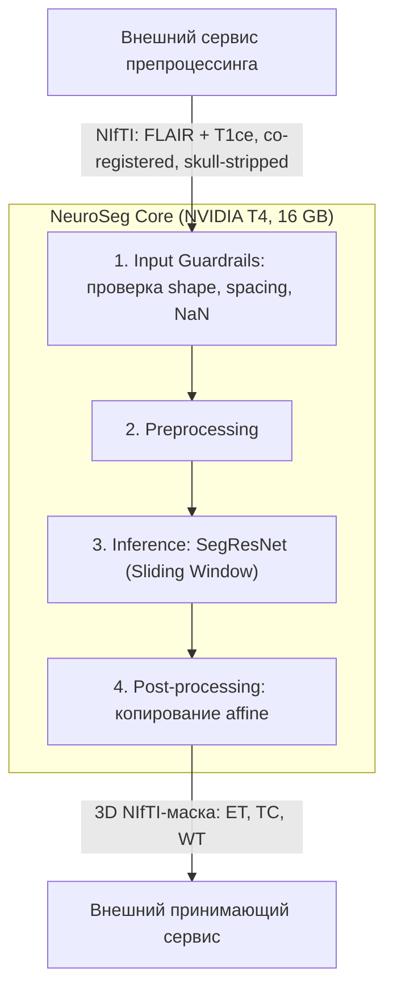

# ML System Design Doc - [RU]

## Дизайн ML системы - NeuroSeg Core MVP 1.1

> **Changelog (пересмотр границ MVP 1.0):** по итогам созвонов с заказчиком и архитектурной декомпозиции границы системы сужены до изолированного ML-ядра сегментации. Задачи препроцессинга (корегистрация, удаление костей), упаковки в DICOM, рендеринга заключений и оркестрации инференса (Triton/Kafka) вынесены в зону ответственности смежных платформенных сервисов.

## Содержание

- [0. Глоссарий](#0-глоссарий)
- [1. Цели и предпосылки](#1-цели-и-предпосылки)
  - [1.1. Зачем идём в разработку продукта?](#11-зачем-идём-в-разработку-продукта)
  - [1.2. Бизнес-требования и ограничения](#12-бизнес-требования-и-ограничения)
  - [1.3. Что входит в скоуп проекта/итерации, что не входит](#13-что-входит-в-скоуп-проектаитерации-что-не-входит)
  - [1.4. Предпосылки решения](#14-предпосылки-решения)
- [2. Методология](#2-методология)
  - [2.1. Постановка задачи](#21-постановка-задачи)
  - [2.2. Блок-схема решения](#22-блок-схема-решения)

### 0. Глоссарий

- **NIfTI (`.nii` / `.nii.gz`)** — стандартный для ML в нейровизуализации формат хранения 3D/4D медицинских объемов. В отличие от сырого клинического DICOM (где каждый 2D-срез лежит в отдельном файле с кучей метаданных пациента), NIfTI хранит весь 3D-тензор единым массивом вместе с пространственной матрицей (`affine`).
- **DICOM (`.dcm`)** — индустриальный стандарт передачи и хранения данных в больницах (напрямую с томографа). Не подается на вход нашей модели; конвертацией в NIfTI и обратно занимаются внешние сервисы.
- **Модальности МРТ (`FLAIR`, `T1ce`, `T1`, `T2`)** — разные режимы сканирования, работающие как цветовые каналы в RGB-картинке. В нашем проекте используются только две.
- **Co-registration (корегистрация)** — пространственное выравнивание (совмещение) разных модальностей МРТ одного пациента в единую систему координат, чтобы конкретный воксель $(x, y, z)$ (аля "пространственный пиксель") на `FLAIR` соответствовал ровно той же анатомической точке на `T1ce`.
- **Воксель (Voxel)** — 3D-аналог пикселя (элемент трехмерной сетки).
- **Skull-stripping (brain extraction)** — этап предобработки, на котором с 3D-снимка алгоритмически удаляются кости черепа, кожа и глаза, оставляя только ткани головного мозга.
- **Spacing (разрешение вокселя)** — физический размер одного вокселя в миллиметрах по осям $(dx, dy, dz)$ (например, $[1.0, 1.0, 1.0]$ мм). Критически важен для 3D-сверток: если `spacing` плавает от снимка к снимку, масштабы объектов в рецептивном поле сети искажаются.
- **Изотропный воксель** — воксель в форме идеального куба ($dx = dy = dz$, в стандарте BraTS — $1 \times 1 \times 1$ мм).
- **Affine (аффинная матрица, $4 \times 4$)** — матрица преобразования координат из заголовка NIfTI. Она связывает индексы вокселей в массиве $(i, j, k)$ с реальными физическими координатами пациента в пространстве томографа $(x, y, z)$. Потеря или искажение `affine` приведет к тому, что предсказанная маска «съедет» относительно мозга при наложении в программу для просмотра.
- **Глиома** — первичная опухоль головного мозга, для которой характерна сложная вложенная структура (матрёшка).
- **ET (Enhancing Tumor)** — активно растущая, накапливающая контраст часть опухоли (хорошо видна на `T1ce`).
- **TC (Tumor Core)** — ядро опухоли, объединяющее `ET` и некротическое (отмершее) ядро внутри него.
- **WT (Whole Tumor)** — весь видимый объем поражения, объединяющий `TC` и окружающий его перитуморальный отек (хорошо виден на `FLAIR`).
- **BraTS (Brain Tumor Segmentation)** — главный международный бенчмарк и открытый датасет по сегментации глиом на МРТ.
- **SegResNet** — 3D-энкодер-декодер архитектура на базе ResNet-блоков с skip-connections (из фреймворка **MONAI**), де-факто индустриальный стандарт для задач 3D-сегментации в медицине.
- **HD95 (95th percentile Hausdorff Distance)** — метрика точности границ в миллиметрах (95-й перцентиль расстояния Хаусдорфа). Показывает, насколько сильно контур предсказанной маски отклоняется от разметки врача, игнорируя единичные выбросы (верхние 5%).

### 1. Цели и предпосылки

#### 1.1. Зачем идем в разработку продукта?

- **Бизнес-цель:** разработать кастомное ML-ядро для автоматической 3D-сегментации глиом по заказу медицинской сети клиник, которая в данный момент не использует средства автоматизации разметки. Цель внедрения на стороне заказчика — ускорить рутинную оценку очагов поражения врачами-радиологами.
- **Почему станет лучше:** для увеличения пропускной способности аппаратов МРТ клиника-заказчик часто использует сокращенный протокол исследования (только 2 модальности: `FLAIR` и постконтрастный `T1ce`). Существующие на рынке готовые решения требуют на вход полного набора из 4 последовательностей (`T1`, `T1ce`, `T2`, `FLAIR`) и критически деградируют в качестве при отсутствии двух из них. Это формирует потребность в разработке кастомной модели, устойчиво работающей в условиях ограниченного протокола заказчика.
- **Что будем считать успехом итерации:**
  1. Качество сегментации (`Dice` и `HD95` по регионам `WT`, `TC`, `ET`) сопоставимо с сильным открытым baseline (SegResNet).
  2. Соблюдение SLA: инференс 3D-объема укладывается в целевой порог `T_max` секунд на целевом железе (NVIDIA T4 16 ГБ VRAM) _(точное значение SLA согласуется с заказчиком по итогам замеров на бейзлайне)_.
  3. На закрытой выборке заказчика врач-эксперт подтверждает пригодность масок (бизнес-валидация).

#### 1.2. Бизнес-требования и ограничения

- **Бизнес-требования:**
  - На входе: два корегистрированных 3D `nifti`-файла (`FLAIR` и постконтрастный `T1ce`) с выполненным удалением черепа (поступают от внешнего сервиса препроцессинга).
  - На выходе: 3D NIfTI-маска с метками субрегионов опухоли (`ET`, `TC`, `WT`), сохраняющая исходную аффинную матрицу входного исследования для точной пространственной привязки в принимающем сервисе.
- **Бизнес-ограничения:**
  - _Юридические (152-ФЗ):_ медицинские данные нельзя отправлять во внешние API.
  - _Инфраструктурные:_ выделяется сервер с 16 ГБ VRAM для обучения и инференса.
  - _Производительность (SLA):_ целевое время обработки одного исследования (`latency`) находится в статусе `TBD` и будет зафиксировано после согласования требований к пропускной способности с заказчиком и проведения бенчмаркинга бейзлайна.
  - _Архитектурные:_ обязательная валидация входных тензоров (совпадение `shape`, `spacing`) перед подачей в модель.
- **Описание бизнес-процесса пилота:** внешний сервис препроцессинга готовит NIfTI -> передает пути/файлы в ML-сервис (`NeuroSeg Core`) -> ML-сервис валидирует входы, выполняет 3D-инференс и постобработку -> возвращает NIfTI-маску принимающему сервису клиники (который отвечает за конвертацию в DICOM и отображение врачу).

#### 1.3. Что входит в скоуп проекта/итерации, что не входит

- **Входит в скоуп MVP:**
  - Работа с зафиксированным датасетом (BraTS) в формате NIfTI (с фильтрацией под 2 целевые модальности (`FLAIR`, `T1ce`) и уже прошедшим удалением костей).
  - Обучение и валидация 3D-модели сегментации (SegResNet) на 2-канальном входе (FLAIR, T1ce).
  - Модуль входного контроля качества данных и алгоритмическая постобработка масок (наследование `affine`).
  - Упаковка ML-ядра в воспроизводимый Python-модуль / Docker-образ с REST/CLI-интерфейсом и экспортом весов в `ONNX` / `TorchScript`.
- **Не входит в скоуп MVP:**
  - Обработка сырых клинических DICOM-файлов (регистрация, удаление черепа).
  - Развертывание оркестраторов уровня Triton Inference Server и брокеров сообщений.
  - Конвертация масок в DICOM.

#### 1.4. Предпосылки решения

- **Данные:** Открытые размеченные датасеты (BraTS). Данные уже предобработаны (изотропный воксель, совмещенные модальности, кости удалены), что полностью соответствует формату данных, который наш модуль будет получать от внешнего сервиса препроцессинга.
- **Бейзлайн:** Архитектура `SegResNet` (MONAI), адаптированная под 2 входных канала (`FLAIR`, `T1ce`).

### 2. Методология

#### 2.1. Постановка задачи

Задача формулируется как **3D Semantic Segmentation** (повоксельная многоклассовая классификация 3D-тензора МРТ):

- `ET` (Enhancing Tumor) — контрастируемая часть опухоли;
- `TC` (Tumor Core) — ядро опухоли (`ET` + некротическое ядро);
- `WT` (Whole Tumor) — весь объем поражения (`TC` + перитуморальный отек).

#### 2.2. Блок-схема решения

Ниже представлена схема работы изолированного ML-ядра (`NeuroSeg Core`) и его взаимодействия со смежными сервисами:

